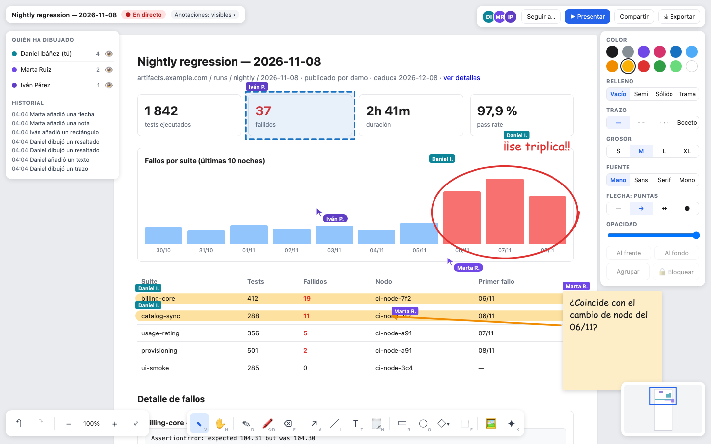

# artifacts-canvas

A shared, live drawing canvas on top of any published artifact (an HTML page): people annotate it together,
Miro-style, and the canvas keeps who drew what. It is the first plugin of
[`pocharlies-org/artifacts`](https://github.com/pocharlies-org/artifacts).



- **The full toolset**: select / move / resize / rotate / marquee, hand and space-pan, freehand pen with
  pressure-like smoothing, highlighter, eraser, arrows that bind to shapes and follow them, line, text, sticky
  notes, rectangle, ellipse and 17 more shapes, frames, pasted or dropped images, and a laser pointer that is
  never stored. Style panel with 12 colours, fills, strokes (solid, dashed, dotted, sketchy), sizes, fonts,
  arrowheads, opacity, order, group and lock. Per-user undo, zoom, zoom to fit, minimap.
- **Live**: strokes appear on every screen while they are drawn; live cursors with names; presence avatars;
  *Presentar* (everyone follows the presenter) and *Seguir a* (follow one person).
- **Attribution**: every shape records who created and last edited it, and when. Name tags, a hover card, an
  authors panel with counts and a per-person show/hide toggle, and a history timeline. Attribution is stamped by
  the server from the verified identity into a separate **ledger** document that clients only receive, never
  write (the drawings live in the content document, the only one a client update reaches), so it cannot be
  forged: a client that writes a ledger root or sends anything on the ledger channel is disconnected (4403) and
  the write is not applied.
- **Isolation**: the artifact runs in a sandboxed, opaque-origin iframe (`sandbox="allow-scripts"`), unchanged; the
  drawings are anchored to its content and move with it.
- **Persistence**: two Yjs documents per artifact (content + ledger), stored as two S3/MinIO objects under
  `_plugins/canvas/`, saved debounced and flushed on last leave. Canvas data never outlives the artifact (expiry + orphan sweep).
- **Export** to PNG and PDF, current view or the whole artifact.
- Spanish UI by default, English with `?lang=en` (or the server config).

This is a re-implementation of the behaviour of tools like tldraw, written from scratch. It contains no tldraw
code, assets or fonts. Runtime dependencies are MIT-licensed: [Yjs](https://github.com/yjs/yjs),
y-websocket, y-protocols, lib0, [perfect-freehand](https://github.com/steveruizok/perfect-freehand) and
[html-to-image](https://github.com/bubkoo/html-to-image).

## Layout

| Path | What |
|---|---|
| `shared/` | The single source of the wire protocol, the Yjs document model and the attribution stamper. Both sides import it (`@pocharlies/artifacts-canvas-shared`), so client and server cannot drift. |
| `client/` | The wrapper page: TypeScript + SVG, no framework, built with Vite. |
| `server/` | The canvas service: rooms, core authz, stamper enforcement, S3 persistence. |
| `dev/` | Local full-stack dev: the real server against a fake core authz and an in-memory S3 (`npm run dev`). |
| `deploy/compose/` | The full system: the core's compose stack plus the canvas as its plugin (real gate, real MinIO, Dex). |
| `e2e-system/` | Playwright suite against that full system (`npm run e2e:system`). |
| `chart/` | Helm chart for the service. |
| `docs/protocol.md` | The single authoritative protocol: routes, key chain, frame, WebSocket messages, attribution, document schema, authz contract, enforcement. |
| `docs/design.md` | Product decisions and design. |
| `docs/mockups/` | The approved UI mockup. |

## Quick start

Requires Node 22+.

```sh
npm install
npm run dev
```

`npm run dev` builds `shared` and `server`, then starts the **real server** against a fake core authz and an
in-memory S3, with the client in `vite build --watch`. It prints ready-to-open URLs: two browser windows as
`alice` and `bob` collaborate through the production code path (authz, stamper, persistence), and anonymous
visitors work on `pub/` keys. The dev core seeds the artifacts under `client/dev/artifacts/`.

For client-only work (no server): `npm run dev -w client` serves the client with an in-memory dev room
(`client/dev/yroom.ts`); open the same URL in two windows to collaborate, `?as=Your%20Name` to pick a
development identity, `?room=x` for a separate room, `?lang=en` for English.

```sh
npm run typecheck      # all workspaces
npm run test           # unit tests (vitest, client + server)
npx playwright install chromium
npm run e2e            # Playwright: client suite (dev stack) + server suite (real server + fake core + S3 mock)
npm run e2e:system     # Playwright against the full system (real core, see "Full system" below)
npm run build          # shared/dist, client/dist (the bundle), server/dist
```

On a phone the toolbar is wider than the screen: it scrolls sideways, and a chevron with a fade on each
side that still hides tools pages it (`docs/screenshots/phone-390x844.png`,
`phone-390x844-toolbar-end.png`, `phone-360x780.png`; `client/e2e/phone.spec.ts` clicks every tool at
390 and 360 px through the chevrons).

Keyboard: V select, H hand (or hold Space), D pen, ⇧D highlighter, E eraser, A arrow, L line, T text, N note,
R rectangle, O ellipse, F frame, K laser, ⌘Z / ⇧⌘Z undo/redo, ⌘A, ⌘D duplicate, ⌘G / ⇧⌘G group, ⇧L lock,
[ / ] back/front, ⇧1 zoom to fit, ⇧0 100%, Delete, Esc.

## Full system: the canvas as a plugin of the core (Docker Compose)

[`deploy/compose/compose.yml`](deploy/compose/compose.yml) runs the **whole system** on a laptop: it
`include`s the core's compose stack (MinIO + Dex + oauth2-proxy + gate + Caddy, from a checkout of
[`pocharlies-org/artifacts`](https://github.com/pocharlies-org/artifacts)), builds the canvas image and
adds the canvas service. Through the core's plugin variables ([`deploy/compose/canvas.env`](deploy/compose/canvas.env))
Caddy routes `/_canvas/` to the canvas, the core bootstrap creates the S3 user `plugin-canvas` (scoped to
`_plugins/canvas/`), and the gate's ACL cache is 2 s. The canvas asks the core's **real**
`POST /_gate/plugin/authz` and stores in the **real** MinIO; nothing is faked. Requires Docker with
Compose v2.24+ and Node 22+.

```sh
git clone https://github.com/pocharlies-org/artifacts.git
git clone https://github.com/pocharlies-org/artifacts-canvas.git
cd artifacts-canvas/deploy/compose
docker compose up -d --build --wait     # the core next to this repo: ../artifacts (else ARTIFACTS_CORE_DIR=...)
```

Publish with the core's CLI; it prints the canvas link next to the artifact link:

```sh
cd ../../../artifacts
ARTIFACTS_ACCESS_KEY=minioadmin ARTIFACTS_SECRET_KEY=minioadmin \
ARTIFACTS_WRITE_BASE=http://127.0.0.1:9000 ARTIFACTS_READ_BASE=http://127.0.0.1:8080 \
ARTIFACTS_PLUGINS="canvas=/_canvas/" \
  cli/publish.sh -u test@example.com,test2@example.com -t 7 examples/report.html
#   INDEX (deliver this link): http://127.0.0.1:8080/artifacts/u/<run>/index.html
#     open with canvas: http://127.0.0.1:8080/_canvas/artifacts/u/<run>/index.html
```

Open the canvas link in two browsers: without a session it sends you through oauth2-proxy to the Dex
login and back. Dex has three dev users — `test@example.com` / `test-password` (*Test One*),
`test2@example.com` / `test2-password` (*Test Two*), `test3@example.com` / `test3-password` (*Test
Three*); the canvas shows those display names, the ACLs use the e-mails — so with the ACL above
the first two collaborate and the third is refused. `-g pub` publishes an anonymous `pub/` artifact (the
dev stack enables anonymous `pub/`; visitors appear as *Anónimo NNNN*). The stack is laptop-only: fixed dev
credentials, every port bound to `127.0.0.1`.

**Full-system e2e** (Playwright, against the running stack; from the repo root, on the Docker host):

```sh
npm ci && npx playwright install chromium
npm run e2e:system      # ARTIFACTS_CORE_DIR defaults to ../artifacts
```

It publishes with the core CLI and checks: two Dex users through the real login chain drawing together
live (strokes before mouse-up, cursors labelled with their display names, server-stamped attribution); a user outside the
ACL refused on the page, the frame and the WebSocket (4403); anonymous drawing on `pub/` as *Anónimo
NNNN* and refused on `u/`; persistence in MinIO at `_plugins/canvas/<key>.ydoc` + `<key>.ydoc.ledger` (with the artifact's `ttl`
tag) across a reload and a canvas container restart; revocation by editing `.acl.json` (the open session
drops with 4403 within the re-check interval, 3 s + the 2 s ACL cache); the opaque-origin artifact iframe;
the adversarial cases (a forged `history` append, `attribution`/`users` overwrites, zero-length structs,
a client LEDGER message, a pending-state DoS, bad style enums and `__proto__` fields, offline edits across a
canvas restart, a client-id claim after a restart, the oauth2-proxy catch-all, a foreign or missing
`Origin`, the expired-artifact leak to a stranger, `/metrics` on the public route, an anonymous visitor
filling the document, a client-chosen anonymous id); and finally the core's own `deploy/compose/e2e.sh`,
which must still pass with the plugin enabled.

Stop everything with `docker compose down -v` (from `deploy/compose/`).

## Production: registering with the core

The canvas is a core plugin (design §8): the core answers *who may see this artifact* (`POST
/_gate/plugin/authz`), the canvas serves everything else under `/_canvas/`. See
[`docs/protocol.md`](docs/protocol.md) for the full contract.

1. **Create the canvas S3 user** (least privilege, scoped to the canvas prefix only): user `plugin-canvas`
   with `Get/Put/Delete/GetTagging/PutTagging` on `_plugins/canvas/*` and `ListBucket` on the prefix. Put its
   credentials in a Kubernetes secret named `plugin-canvas-s3` (the name the chart and the core entry default
   to): the core's bootstrap Job reads that secret to create/attach the user, and the canvas chart consumes the
   same one. The canvas never sees artifact data outside that prefix, and the core keeps its own users for reads.
2. **Register the plugin in the core's Helm values** (`pocharlies-org/artifacts` chart). The name must be a
   DNS-1123 label; the path is the plugin prefix the core links into:

   ```yaml
   plugins:
     - name: canvas
       pathPrefix: /_canvas/
       service: canvas-artifacts-canvas   # the canvas chart's Service (release `canvas`)
       namespace: sso                     # where the canvas chart is installed
       port: 8080
       secretName: plugin-canvas-s3
   ```

   The core then emits canvas links as `<read_base>/_canvas/<bucket>/<key>`; the canvas server accepts both
   that shape and `/_canvas/<key>` (the bucket segment is stripped — see the key chain in
   [`docs/protocol.md`](docs/protocol.md) §1.2).
3. **Install the canvas chart** ([`chart/`](chart)), pointing at the core:

   ```sh
   helm install canvas ./chart -n sso \
     --set core.publicHost=<your artifacts host> \
     --set s3.bucket=artifacts \
     --set s3.endpoint=http://minio.minio.svc.cluster.local:9000
   ```

   The defaults match the core chart, so `core.publicHost` (the core's `artifactsHost`) is the only
   required value. It has **no default**: rendering fails when it is empty or an `example.*`
   placeholder (unless both `core.artifactBaseUrl` and `core.allowedOrigins` are set). With
   `deployment.replicas` > 1, `anon.cookieSecretRef.name` is required as well (rendering fails
   otherwise):

   | Value | Default | Core chart object |
   |---|---|---|
   | `core.gateAuthzUrl` | `http://artifact-gate.sso.svc.cluster.local:8081/_gate/plugin/authz` | Service `artifact-gate` (ns `sso`), decision port `auth` 8081 (never routed publicly) |
   | `core.artifactBaseUrl` | `https://<core.publicHost>/<bucket>` | the artifacts host's edge: Traefik forwardAuth to the gate, then the gate-signed MinIO read (the frame route fetches with the visitor's cookie, like a browser) |
   | `core.loginUrl` | `/oauth2-artifacts/sign_in?rd={rd}` | `oauth2-proxy-artifacts` (`--proxy-prefix=/oauth2-artifacts`) |
   | `core.allowedOrigins` | `[https://<core.publicHost>]` | the origin browsers open the canvas from (WebSocket Origin check) |
   | `core.bucket` | `s3.bucket` | `minio.bucket` |
   | `networkPolicy.ingressNamespace` | `traefik-system` | namespace of the Traefik controller serving the core's IngressRoutes |
   | `core.namespace` | `sso` | `namespaces.sso` (the gate) |
   | `metrics.port` / `networkPolicy.metricsNamespaces` | `9091` / `[monitoring]` | internal Prometheus port, not in any route |
   | `anon.cookieSecretRef.name` / `.key` | `""` / `anon-cookie-secret` | an operator-created Secret holding `ANON_COOKIE_SECRET` (≥ 32 random bytes); required when `deployment.replicas` > 1, recommended always (without it anonymous cookies and ids reset on every restart) |

   The chart ships the Deployment, Service (`http` 8080, `metrics` 9091), ConfigMap, ServiceAccount and a
   NetworkPolicy: `http` only from the ingress controller's namespace and the core's namespace, `metrics`
   only from `networkPolicy.metricsNamespaces`.

## Configuration reference (server)

All values are environment variables; the chart maps them from `values.yaml`.

| Variable | Default | Meaning |
|---|---|---|
| `GATE_AUTHZ_URL` | — (required) | Core internal authz endpoint (`POST /_gate/plugin/authz`). |
| `ARTIFACT_BASE_URL` | — (required) | Base URL the frame route fetches artifact HTML from, with the visitor's cookie: the core's edge, e.g. `https://<artifacts host>/<bucket>` (chart default) or `http://caddy/artifacts` (compose). |
| `S3_BUCKET` | — (required) | Bucket holding the artifacts and the canvas objects. |
| `HOST` / `PORT` | `0.0.0.0` / `8080` | Listen address. |
| `S3_ENDPOINT` | (AWS default) | S3-compatible endpoint (MinIO, etc.). |
| `S3_REGION` | `us-east-1` | |
| `S3_ACCESS_KEY_ID` / `S3_SECRET_ACCESS_KEY` | (SDK default chain) | The `plugin-canvas` credentials. |
| `S3_FORCE_PATH_STYLE` | `true` | Path-style addressing (needed by MinIO). |
| `CANVAS_PREFIX` | `_plugins/canvas` | Prefix of the stored canvas objects (`<prefix>/<key>.ydoc` content, `<prefix>/<key>.ydoc.ledger` ledger). |
| `AUTHZ_TIMEOUT_MS` | `3000` | Gate call timeout; anything late or wrong fails closed. |
| `AUTHZ_RECHECK_SECONDS` | `300` | Re-check interval per connection; on a deny the client is dropped (4403). |
| `FRAME_FETCH_TIMEOUT_MS` | `10000` | Artifact fetch for the frame route. |
| `STATIC_DIR` | `client/dist` | Built client bundle served under `/_canvas/_/`. |
| `CANVAS_INJECT_CONFIG` | `true` | Inject the wrapper config element (§2 of the protocol). |
| `LOGIN_URL` | (empty) | Where a visitor **without a session** who opens the wrapper of a non-anonymous artifact is sent (`302`); `{rd}` is replaced by the URL-encoded original path, e.g. `/oauth2/sign_in?rd={rd}` (compose) or `/oauth2-artifacts/sign_in?rd={rd}` (core chart). Empty = `403`. Bearer callers always get the `403`. |
| `SAVE_DEBOUNCE_MS` | `2000` | Persistence debounce (flushed on last leave and shutdown). |
| `SWEEP_INTERVAL_SECONDS` | `3600` | Orphan sweep: deletes canvas objects whose artifact is gone/expired. |
| `READYZ_CACHE_MS` | `5000` | `/readyz` caches the `HeadBucket` result. |
| `EXPIRED_REASONS` / `GONE_REASONS` | `expired` / `object-missing` | Gate reasons classified as expired/gone. |
| `ARTIFACT_PREFIXES` | (all) | Optional allowlist of artifact key prefixes the canvas serves. |
| `ANON_ALLOWED_PREFIXES` | `pub/` | Prefixes where anonymous access is accepted. |
| `MAX_CONNS_PER_ROOM` / `MAX_CONNS_PER_ROOM_ANON` / `MAX_CONNS_PER_ANON_VISITOR` | `50` / `10` / `2` | Room capacity (anon gets the stricter set); over capacity closes `1013`. |
| `MSG_RATE_PER_SEC` / `MSG_BURST` | `120` / `240` | Per-connection message rate → `4429`. |
| `ANON_MSG_RATE_PER_SEC` / `ANON_MSG_BURST` | `30` / `60` | Same for anonymous. |
| `MAX_DOC_BYTES` / `ANON_MAX_DOC_BYTES` | `20 MiB` / `5 MiB` | Content **plus ledger**: an update that would grow the room past the sender's cap is refused and only that connection closes `4413`; the room stays open, and an update that only deletes always passes. |
| `WS_MAX_BUFFERED_BYTES` | `8 MiB` | A peer that stops reading is dropped once the server holds this much unsent data for it (beyond the join burst). |
| `SYNC_BYTES_PER_SEC` / `SYNC_BURST_BYTES` | `1 MiB` / `4 MiB` | Bytes of sync step-2 answers after the first one of a connection → `4429`; a later step 1 with an empty state vector closes `4429` at once. Anonymous: `ANON_SYNC_BYTES_PER_SEC` / `ANON_SYNC_BURST_BYTES` (`256 KiB` / `1 MiB`). |
| `JOIN_RATE_PER_MIN` / `JOIN_BURST` | `30` / `20` | Joins per signed-in user → `4429`. Anonymous: `ANON_JOIN_RATE_PER_MIN` / `ANON_JOIN_BURST` (`10` / `6`) per visitor, and `ANON_ROOM_JOIN_RATE_PER_MIN` / `ANON_ROOM_JOIN_BURST` (`60` / `30`) per room. |
| `CPU_MS_PER_SEC` / `CPU_BURST_MS` | `250` / `5000` | Server CPU time a connection's messages may use → `4429`. Anonymous: `ANON_CPU_MS_PER_SEC` / `ANON_CPU_BURST_MS` (`60` / `1000`). |
| `ATTRIBUTION_RETENTION_DAYS` | `30` | Attribution entries of shapes deleted longer ago than this are pruned from the ledger. |
| `MAX_MESSAGE_BYTES` / `ANON_MAX_MESSAGE_BYTES` | `8 MiB` / `2 MiB` | Message size limit → `4413`. |
| `MAX_IMAGE_BYTES` / `ANON_MAX_IMAGE_BYTES` | `2 MiB` / `1 MiB` | Announced to the client as its paste cap. |
| `ALLOWED_ORIGINS` | origin of `ARTIFACT_BASE_URL` | Comma-separated browser origins (`scheme://host[:port]`) allowed to open the WebSocket. A missing, `null` or foreign `Origin` is closed `4403` (cross-site WebSocket hijacking guard). |
| `METRICS_PORT` / `METRICS_HOST` | `9091` / `0.0.0.0` | Internal Prometheus listener (`/metrics` only; `0` disables it). The public listener answers `404` for `/metrics`. |
| `ANON_COOKIE_SECRET` | (random per process) | Signs the anonymous-visitor cookie: the server assigns the *Anónimo NNNN* pseudonym (`?anon=` is only a hint for the number shown) and the anonymous attribution id `anon:<visitor id>` is derived from the cookie's nonce. Chart: `anon.cookieSecretRef` (a Secret reference, never a value); required with more than one replica, since every pod must verify the same cookie. |
| `LOG_LEVEL` | `info` | `debug` / `info` / `warn` / `error`. |

### Container image

```sh
docker build -f server/Dockerfile -t artifacts-canvas-server:dev .
```

The image builds all three workspaces from the root lockfile and runs `server/dist/index.js` as a non-root
user; the built client bundle ships as the static dir (`STATIC_DIR=/app/static`).

## License

Apache License 2.0. Copyright 2026 Daniel Ibáñez. See [LICENSE](LICENSE) and [NOTICE](NOTICE).
